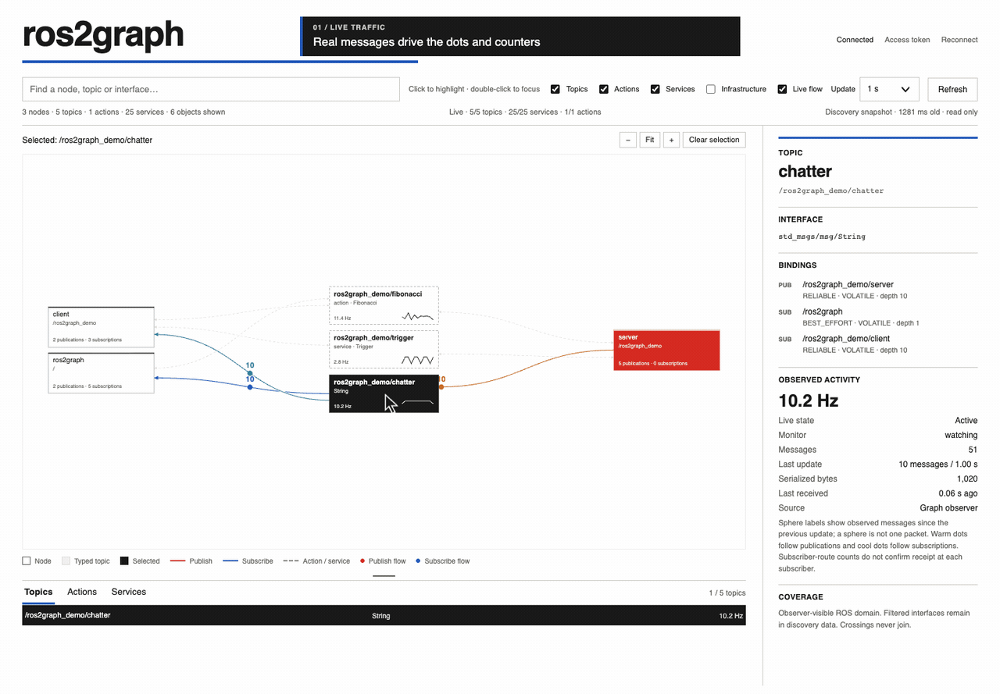
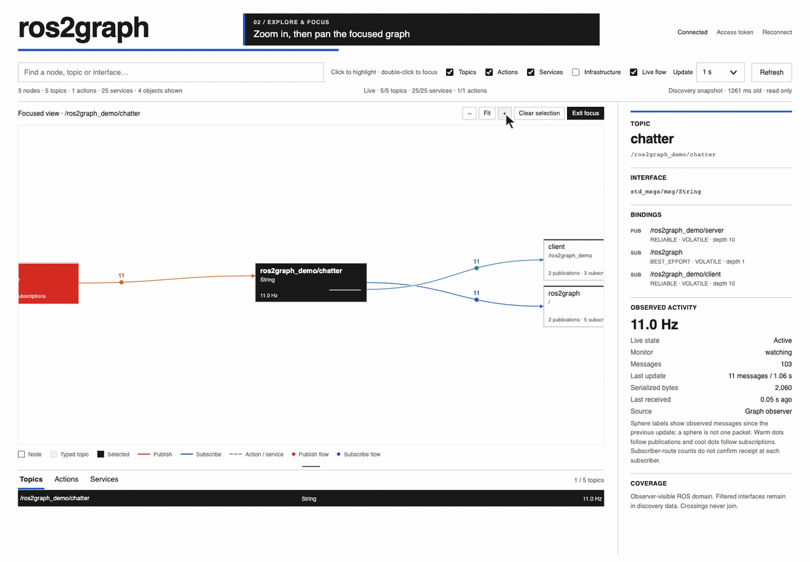
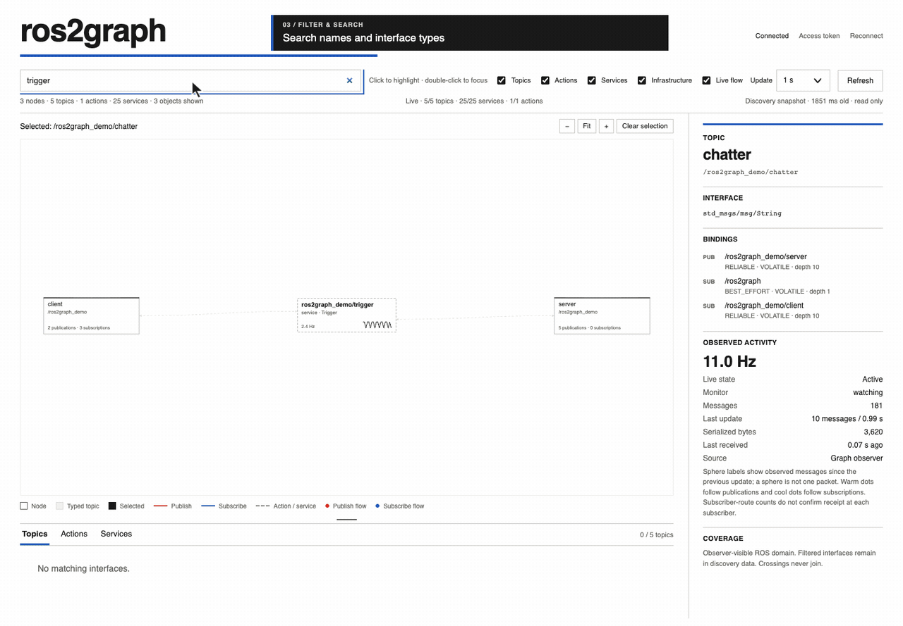
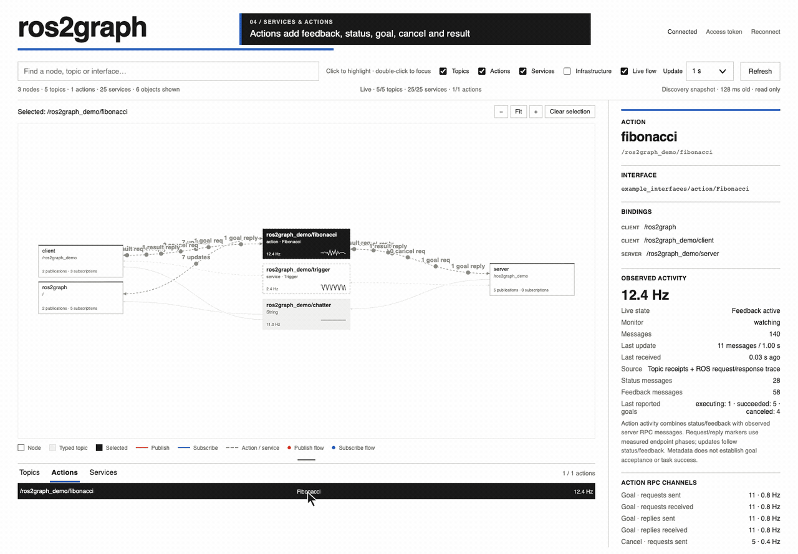
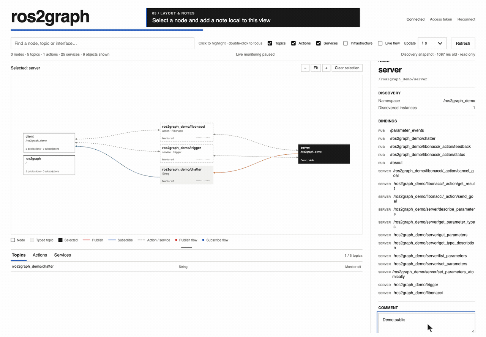

# ros2graph

A standalone, browser-based ROS 2 graph explorer. See nodes, typed topics,
services and actions, then follow their live activity without changing your
ROS application.

Select a preview to watch the full recording.

**See live traffic.** Watch observed rates, message counts and activity along
selected paths.

[](https://raw.githubusercontent.com/vincent-tvincent/ros2graph/main/docs/demos/playback/01-live-traffic.webp)

[Watch · 18 s](https://raw.githubusercontent.com/vincent-tvincent/ros2graph/main/docs/demos/playback/01-live-traffic.webp) · [Original GIF](https://raw.githubusercontent.com/vincent-tvincent/ros2graph/main/docs/demos/01-live-traffic.gif)

**Follow relationships.** Select connected paths, isolate a topic, then zoom,
pan and return to the overview.

[](https://raw.githubusercontent.com/vincent-tvincent/ros2graph/main/docs/demos/playback/02-explore-focus.webp)

[Watch · 17 s](https://raw.githubusercontent.com/vincent-tvincent/ros2graph/main/docs/demos/playback/02-explore-focus.webp) · [Original GIF](https://raw.githubusercontent.com/vincent-tvincent/ros2graph/main/docs/demos/02-explore-focus.gif)

**Filter and search.** Show topics, actions and services independently, reveal
internal ROS interfaces and find objects by name or type.

[](https://raw.githubusercontent.com/vincent-tvincent/ros2graph/main/docs/demos/playback/03-filter-search.webp)

[Watch · 20 s](https://raw.githubusercontent.com/vincent-tvincent/ros2graph/main/docs/demos/playback/03-filter-search.webp) · [Original GIF](https://raw.githubusercontent.com/vincent-tvincent/ros2graph/main/docs/demos/03-filter-search.gif)

**Inspect service and action traffic.** View request/reply phases, feedback,
status and goal/cancel/result channels.

[](https://raw.githubusercontent.com/vincent-tvincent/ros2graph/main/docs/demos/playback/04-services-actions.webp)

[Watch · 21 s](https://raw.githubusercontent.com/vincent-tvincent/ros2graph/main/docs/demos/playback/04-services-actions.webp) · [Original GIF](https://raw.githubusercontent.com/vincent-tvincent/ros2graph/main/docs/demos/04-services-actions.gif)

**Arrange your workspace.** Resize and scroll the interface list, use keyboard
controls and add local node notes.

[](https://raw.githubusercontent.com/vincent-tvincent/ros2graph/main/docs/demos/playback/05-layout-notes.webp)

[Watch · 25 s](https://raw.githubusercontent.com/vincent-tvincent/ros2graph/main/docs/demos/playback/05-layout-notes.webp) · [Original GIF](https://raw.githubusercontent.com/vincent-tvincent/ros2graph/main/docs/demos/05-layout-notes.gif)

*Recorded from the included hardware-free ROS demo. Detailed service/action
phase counts use the optional trace collector; captions and cursors are recording
overlays. [Recording instructions](docs/demos/README.md#record-the-demos-again).*

Install it in a ROS workspace, source the same ROS environment as your
application, and run:

```bash
ros2 run ros2graph ros2graph
```

Open **http://localhost:8080/**. The browser needs no ROS installation.

## What it provides

- Automatic discovery of nodes, topics, service clients/servers and action
  clients/servers, including names, namespaces, message types and topic QoS.
- The original Swiss-style graph: unique node blocks, typed interface blocks,
  smooth curves, warm publish colors and cool subscribe colors.
- Click to highlight a complete related path; double-click to isolate it.
  Search, zoom, pan, fit, a detail inspector and a resizable interface list.
- Independent **Topics**, **Actions** and **Services** visibility checkboxes.
  Filtering changes the view, not what the observer measures.
- **Live flow** with continuous counters, rate histories and moving flow dots
  on focused paths. Choose a 0.5, 1, 2, 5 or 10 second browser update interval.
- Optional local service/action request-and-response tracing through standard
  ROS tracepoints. No application source instrumentation is required.
- A small read-only graph HTTP API for other tools. No arbitrary topic
  publisher, service caller, action client or robot control endpoint.

## Requirements and compatibility

The observer needs a sourced ROS 2 installation with `rclpy`, Python 3.10 or
newer, `rosidl_runtime_py`, and `aiohttp`. Install your robot's message packages
in that same environment to measure its custom topics. Discovery can still
list a topic whose message definition is not installed; its measurements will
explain that the type cannot be loaded.

The package uses standard ROS graph APIs and is independent of robot type.
Installation, startup and ordinary graph monitoring have passed on ROS Humble,
Jazzy and Lyrical. Detailed RPC tracing has been verified on Lyrical with Fast DDS.
This does **not** mean every ROS distribution, RMW implementation and operating
system has been physically tested. See [validation coverage](docs/validation.md).
An unsupported API or unavailable measurement is reported explicitly rather
than filled with invented traffic.

The web UI has no npm build, CDN, JavaScript framework or downloaded font.
Node.js is only needed for frontend development tests. LTTng/Babeltrace are
optional Linux dependencies for detailed RPC traffic, not prerequisites for
opening the graph or monitoring topics.

## Install in a ROS workspace

Use Bash and source your installed ROS distribution first. This example uses
Jazzy; substitute your installed distribution and workspace paths.

```bash
source /opt/ros/jazzy/setup.bash
mkdir -p ~/ros2graph_ws/src
cd ~/ros2graph_ws/src
git clone https://github.com/vincent-tvincent/ros2graph.git
cd ~/ros2graph_ws
rosdep install --from-paths src --ignore-src -r -y
colcon build --symlink-install --packages-select ros2graph
source install/setup.bash
ros2 run ros2graph ros2graph
```

`rosdep` and `colcon` must already be installed; on a ROS-enabled Ubuntu
installation these are normally provided by `python3-rosdep` and
`python3-colcon-common-extensions`. If rosdep has never been initialized on
that computer, initialize it with `sudo rosdep init` once, then `rosdep update`
as your regular user.

An existing robot workspace works equally well: clone into its `src/` directory
and build only `ros2graph`. Rebuilding or modifying robot packages is unnecessary.
When using Python virtual environments, use the ROS distribution's Python
interpreter and make its system packages visible; a different Python ABI cannot
import its compiled ROS modules.

### Attach to a running robot

In a separate terminal, source the robot's normal ROS underlay and overlays,
including the newly built ros2graph package, and use the same discovery settings:

```bash
source /opt/ros/jazzy/setup.bash
source ~/robot_ws/install/setup.bash
source ~/ros2graph_ws/install/setup.bash
# Match the robot's actual environment; 42 is only an example.
export ROS_DOMAIN_ID=42
ros2 run ros2graph ros2graph
```

Keep the robot's RMW, discovery-server or discovery-range settings and SROS2
credentials/permissions where applicable. ros2graph does not change them or
select a hard-coded domain. A useful first check is that `ros2 node list` and
`ros2 topic list` in this terminal see the expected robot.

Nodes may be on other computers if normal ROS discovery and transport reach
them. Topic rates are what this observer receives, not a guarantee that each
other subscriber received the same messages. Detailed RPC tracing is local to
the collector host; it does not silently claim measurements for remote nodes.

### Try the included hardware-free demo

The demo creates ordinary publisher/subscriber nodes, a Trigger service and a
Fibonacci action, with periodic requests, feedback, results and cancellations.
It uses only standard interfaces and opens no hardware.

In two terminals with the same sourced workspace and ROS domain:

```bash
# Terminal 1
ros2 run ros2graph demo_graph
```

```bash
# Terminal 2
ros2 run ros2graph ros2graph
```

Open the viewer and enable **Live flow**. Select a topic to see its connected
paths and actual counter-driven activity. Stop either process with Ctrl-C.
The viewer can join after the demo is already running. For detailed service
request/reply counts, use the optional tracing setup below before starting
the demo nodes.

## Remote browser access

The default listener is loopback-only. You can view a robot-hosted instance
without exposing another network service:

```bash
ssh -L 8080:127.0.0.1:8080 user@robot-host
```

Then open http://localhost:8080/ on your laptop. The ROS observer stays on the
robot host; DDS traffic does not have to cross the browser connection.

For direct access on your chosen network:

```bash
ros2 run ros2graph ros2graph --ros-args -p host:=0.0.0.0 -p port:=8080
```

Optional HTTPS and a bearer token are supported without an account system:

```bash
ros2 run ros2graph ros2graph --ros-args \
  -p host:=0.0.0.0 -p port:=8444 \
  -p tls_cert:=/absolute/path/cert.pem \
  -p tls_key:=/absolute/path/key.pem \
  -p token_file:=/absolute/path/viewer-token.txt
```

The token file contains one token. The browser asks for it when needed and
retains it only in memory; it is not placed in URLs or localStorage. Configure
TLS or use the SSH tunnel when transporting a token across an untrusted network.
The listener exposes graph metadata, not robot commands. Its POST endpoints
manage observation subscriptions, so a Live watch still adds ROS traffic.

## Configuration

All parameters are read at startup and are read-only while running. To change
them, restart the viewer; no robot application restart is needed. Relative
file paths are relative to the viewer's working directory; absolute paths are
recommended for deployment.

```bash
ros2 run ros2graph ros2graph --ros-args \
  --params-file /absolute/path/ros2graph.yaml
```

Start from [config/ros2graph.yaml](config/ros2graph.yaml).

| Parameter | Default | Purpose |
| --- | --- | --- |
| `host` | `127.0.0.1` | HTTP bind address. |
| `port` | `8080` | HTTP or HTTPS port. |
| `refresh_s` | `2.0` | Topology discovery refresh, 0.2–30 seconds. Independent of browser polling. |
| `watch_enabled` | `true` | Allow browser-managed Live watch leases. |
| `watch_max_topics` | `256` | Maximum simultaneous raw observer subscriptions; raise for a larger graph. |
| `watch_max_clients` | `8` | Maximum concurrent browser watch leases, 1–8. |
| `watch_lease_s` | `12.0` | Observation lease lifetime, 3–30 seconds. Browser renewals are independent of the visible update interval. |
| `watch_messages_per_window` | `10000` | Per-topic receipt budget over five seconds; range 1–50000. |
| `rpc_trace_socket` | empty | Optional local collector socket; empty disables RPC tracing integration. |
| `token_file` | empty | Optional bearer-token text file. |
| `tls_cert`, `tls_key` | empty | Optional TLS certificate and key, supplied together. |

The supplied launch file is only a convenience:

```bash
ros2 launch ros2graph ros2graph.launch.py host:=127.0.0.1 port:=8080
```

You do not need to include it in a robot's launch file. The direct `ros2 run`
command is the standard way to attach the viewer independently.

## Optional service and action traffic tracing

Service/action **discovery** works immediately. Action feedback and status are
ordinary ROS topics and can be observed by Live watch. Exact service request
and response phases need instrumentation that the ROS graph API does not supply.

ros2graph includes a separate Linux collector using the standard ROS 2
LTTng tracepoints. It counts request-sent, request-received, response-sent and
response-received events, including the goal/cancel/result services behind an
action. It neither calls these services nor sends action goals to measure them.
The tracing mechanism follows the upstream
[ROS 2 tracing design](https://github.com/ros2/ros2_tracing/blob/rolling/doc/design_ros_2.md).

Install the optional packages appropriate for your ROS distribution:

```bash
sudo apt install lttng-tools python3-bt2 ros-${ROS_DISTRO}-tracetools
```

The ROS/RMW build must emit the required request/reply and endpoint-identity
tracepoints. Availability depends on distribution and RMW; installing the CLI
alone cannot add absent tracepoints to already compiled libraries.

Use three terminals, all with the same ROS environment:

```bash
# Terminal 1: start the collector BEFORE the nodes to be measured.
ros2 run ros2graph rpc_trace_collector --socket /tmp/ros2graph-$UID/rpc-trace.sock
```

```bash
# Terminal 2: start your existing application normally, or the included demo.
ros2 run ros2graph demo_graph
```

```bash
# Terminal 3: connect the viewer to that collector.
ros2 run ros2graph ros2graph --ros-args \
  -p rpc_trace_socket:=/tmp/ros2graph-$UID/rpc-trace.sock
```

Enable **Live flow** in the browser. No application-code edits, wrapper
decorators, custom logging or project-specific configuration are needed.

Initialization events associate handles with nodes and interfaces. If the
application was already running before tracing began, its missing mappings are
reported as unavailable; topology and normal topic monitoring continue. Start
the collector before your next normal application startup to obtain those
mappings. ros2graph never restarts application nodes for you.

Collector capacity and lifecycle can be configured independently:

| Collector flag | Default | Purpose |
| --- | --- | --- |
| `--socket PATH` | Per-user runtime directory | Socket also supplied to the viewer's `rpc_trace_socket`. The examples specify an explicit shared path. |
| `--max-endpoints N` | `256` | RPC/node mapping capacity; increase for larger systems. This is separate from `watch_max_topics`. |
| `--interval SECONDS` | `1` | Snapshot interval, clamped to 0.25–2 seconds. |
| `--parent-pid PID` | none | Optional process-tree scope instead of all observable processes belonging to this user. |
| `--exit-with-parent` | off | Stop if the collector's launching parent exits. |

The collector is a separate process because it has Linux-specific dependencies
and a different lifetime from the web viewer. It uses a private local socket
and bounded temporary snapshots, and removes its own session and temporary
files on clean exit. It does not write a permanent payload archive. See
[measurement semantics](docs/measurements.md) for scope, identity checks,
capacity limits and the meaning of every counter.

## Read the graph correctly

- **Black block:** current selection. Related publishers use warm colors and
  related subscribers use cool colors. Color does not imply hardware ownership.
- **Solid curve:** publish/subscribe relationship. **Dashed curve:** a service
  or action relationship. Crossing curves do not connect.
- **Moving dot:** recent observed activity on that highlighted path. A dot is
  an aggregate indicator, not one network packet. Its number is the observed
  message-count change over the update interval.
- **Topic rate:** messages received by this observer. Publisher GIDs can
  attribute those receipts to a publisher; they do not prove delivery to every
  other subscriber drawn in the graph.
- **Service rate:** server requests received plus responses sent. It is a
  message-phase rate, not a count of unique completed calls. The inspector
  separates the four phases.
- **Action rate:** observed feedback/status plus measured server-side
  goal/cancel/result traffic. The inspector preserves these components.
- **0 Hz:** no receipts/events were observed during the interval. This does not
  prove the application itself is idle. **Unavailable**, **capacity**
  or **throttled** is different from idle; the inspector explains the reason.
- **Unresolved endpoint:** the middleware did not report a trustworthy node
  identity. ros2graph preserves that uncertainty rather than inventing a label.
  Middleware transport aliases are normally hidden by the Infrastructure filter.

Live watch uses shared, bounded subscriptions across browser tabs. Closing a
tab releases or expires its observation lease; another tab's watch continues.
This is only observation lifetime management, not a robot control timeout.
UI filters and focus do not discard measurements of other discoverable topics.
Raw images and point clouds are eligible for continuous measurement, but
subscribing still consumes middleware/transport bandwidth and CPU.

## HTTP API

All paths are relative to the viewer URL. Responses are JSON and are not
cached. If `token_file` is configured, `/api/*` requires
`Authorization: Bearer TOKEN`. Static assets and `/healthz` do not expose that
token. No CORS wildcard is enabled.

| Method | Path | Request / result |
| --- | --- | --- |
| GET | `/healthz` | Process readiness, application name and version. Not a ROS discovery-health claim. |
| GET | `/api/graph` | Graph snapshot: nodes, topics, services, actions, edges, QoS, coverage, activity and measurement reasons. |
| POST | `/api/graph/watch` | `{ "operation": "acquire", "client_id": "UUID" }`; returns `lease_id` and `expires_in_ms`. |
| POST | `/api/graph/watch` | `{ "operation": "renew", "lease_id": "..." }`; renew only your own lease. |
| POST | `/api/graph/watch` | `{ "operation": "release", "lease_id": "..." }`; release only your own lease. |
| POST | `/api/graph/sample` | `{ "topic": "/example", "duration_s": 5 }` for a bounded one-off sample, or `{ "topic": "/example", "stop": true }`. Continuous Live watch is the normal measurement path. |

Lease rejection can be HTTP 200 with `accepted: false`; inspect its `code` and
`reason`. Invalid requests use HTTP 400, missing authentication 401, a rejected
browser origin 403, oversized bodies 413 and non-JSON POST bodies 415.
No endpoint returns topic/service payload content. See
[docs/api.md](docs/api.md) for field contracts and a runnable observation example.

## Troubleshooting

| Symptom | Check |
| --- | --- |
| `Package 'ros2graph' not found` | Build it and source that workspace's `install/setup.bash` in the current terminal. |
| `ModuleNotFoundError: rclpy` | Source ROS and use the system Python ABI it was built for, not an unrelated venv. |
| Empty or incomplete graph | Compare `ros2 node list` from the same shell; check domain, RMW/discovery configuration, networking and SROS2 permissions. |
| Custom topic is visible but unmeasured | Source/install the package that defines its message type on the observer host. |
| Topic is measured at a lower rate | The number is the observer's actual receipt rate. Check QoS, dropped best-effort traffic and host/network load. |
| Capacity or throttled message | Inspect watch coverage; increase `watch_max_topics` or the per-topic budget as appropriate. Global bounds and trace loss are disclosed, not reported as zero. |
| Services/actions visible without RPC counts | Start/configure the optional collector; confirm tracepoint support and start it before the target nodes. |
| Identical node names in multiple processes | ROS graph discovery cannot always distinguish duplicate FQNs. Instance counts and unresolved identities remain explicit. |
| Browser cannot connect remotely | Default binding is loopback. Use an SSH tunnel or explicitly bind a network address; check the chosen port. |
| Old view after an update | Refresh the page. Installed assets use `Cache-Control: no-store`. |
| Port already in use | Stop the other viewer or choose `-p port:=8081`; robot node restarts are unnecessary. |

## Development and validation

```bash
# Pure-Python observer/HTTP tests; ROS is not needed for these fakes.
python3 -m pytest tests

# No browser or npm install needed for the graph logic tests.
node --test tests/*.mjs

# Real ROS tests after building and sourcing the package.
bash tests/run_ros_smoke.sh --without-trace
# With the optional Linux trace dependencies and supported tracepoints:
bash tests/run_ros_smoke.sh
```

The ROS smoke test uses a separate domain and local demo nodes. It must not be
pointed at a robot's control environment. See the script's options and
[validation coverage](docs/validation.md) for traced and untraced runs.

| Directory | Responsibility |
| --- | --- |
| `ros2graph/node.py`, `server.py`, `settings.py` | ROS process, HTTP adapter, startup configuration. |
| `ros2graph/graph_*.py` | Generic discovery, topic counters, transport identity and RPC projection. |
| `ros2graph/rpc_trace*.py` | Optional collector/client, metadata counters and bounded trace storage. |
| `ros2graph/web/` | Standalone browser application and original graph renderer. |
| `ros2graph/demo.py` | Standard-interface example graph, no hardware. |
| `launch/`, `config/` | Optional startup convenience and parameter template. |
| `tests/` | Unit and isolated ROS integration checks. |

Contributions should preserve the distinction between discovery, observer
receipt and confirmed endpoint activity. Include a focused regression test for
changed measurement or selection behavior. See [CONTRIBUTING.md](CONTRIBUTING.md).

## License

Apache License 2.0. See [LICENSE](LICENSE) and [NOTICE](NOTICE).
