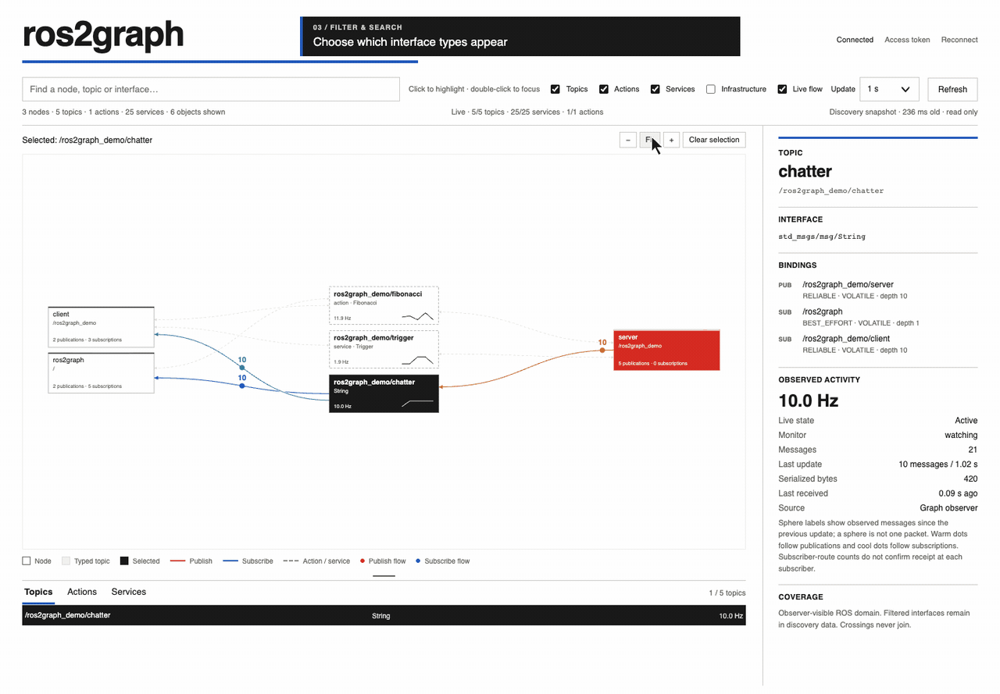
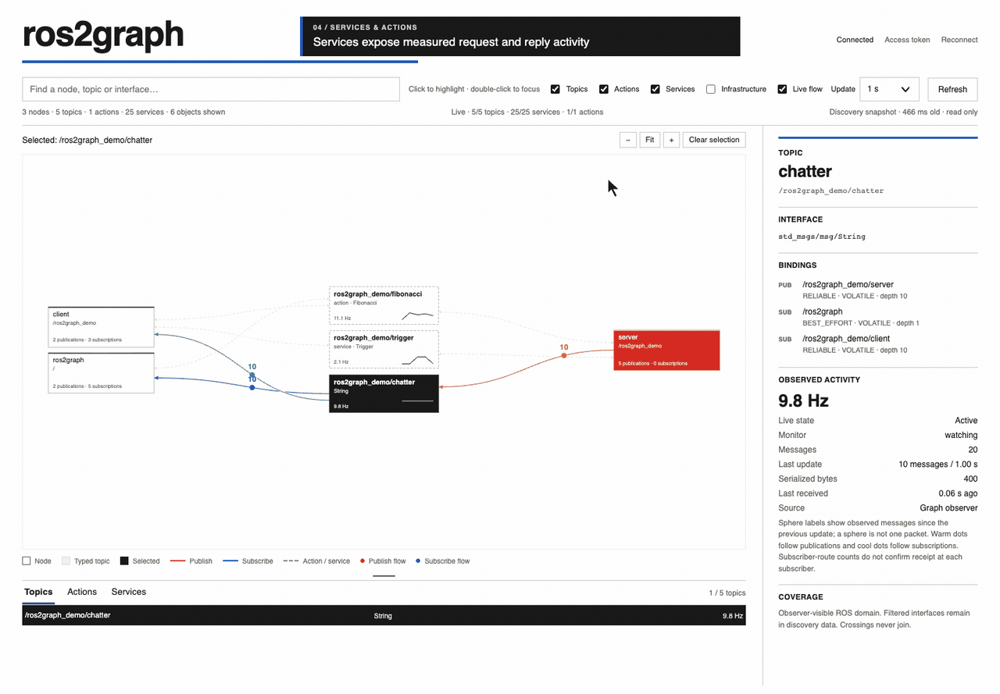

# ros2graph demonstrations

These GIFs record the actual browser application connected to the included
ROS demo. Topic counters, rates, moving markers and service/action phases come
from running ROS nodes. They are not replayed fixtures or invented animation.
Only the caption strip and visible mouse cursor are recording overlays.

The demo uses String, Trigger and Fibonacci interfaces and operates no hardware.
Detailed service/action activity uses the optional Linux trace collector started
before the demo nodes. GIF playback is at the recorded speed, without audio.

## 1. Live traffic

Select a topic, follow its moving markers and observed counters, change the
browser update interval, then pause and resume this view's monitoring using Live flow.
Other viewers can keep their own observation leases active.
Dot labels count observed messages per update interval, not network packets.


## 2. Explore and focus

Select a topic to highlight publishers and subscribers. Follow an inspector
binding to a node, double-click a topic to isolate its neighbors, zoom and pan,
then use Fit and Exit focus to restore the overview.


## 3. Filter and search

Independently hide topics, actions or services, reveal infrastructure, search
interface names, and return to the clean overview. Visibility filters do not
change the underlying measurement subscriptions.



## 4. Services and actions

Browse service and action tabs. Inspect the four request/reply phases, action
status and feedback, and goal/cancel/result channels alongside the live graph.
The service headline counts message phases rather than unique completed calls.



## 5. Layout and node notes

Drag the divider to resize the interface list, switch its tabs, add a local
node annotation, and use the separator's keyboard controls to restore its height.
Annotations change only the current browser view, not the ROS nodes.


## Record the demos again

1. Build and start the collector, demo and viewer following the
   [main README](../../README.md#optional-service-and-action-traffic-tracing).
   Use the supplied `/ros2graph_demo` example rather than a physical robot.
2. On the recording computer, install Node.js 20+, FFmpeg and Playwright. These
   are development tools; the deployed viewer does not need them.
3. Run the capture script from the repository root:

```bash
npm install --prefix /tmp/ros2graph-demo-tools playwright
/tmp/ros2graph-demo-tools/node_modules/.bin/playwright install chromium
NODE_PATH=/tmp/ros2graph-demo-tools/node_modules \
  node tools/record_demos.cjs \
  --url http://127.0.0.1:8080 \
  --out /tmp/ros2graph-recordings
```

FFmpeg must be on `PATH`. To use an existing Chrome installation, add
`--chrome /absolute/path/to/chrome`. For a remote viewer, use an SSH tunnel
as described in the main README. The script opens a fresh browser context for
each clip and does not use your personal browser profile.

The output directory contains GIFs, a recording manifest and source PNG frames.
`--only 01-live-traffic` records one clip; comma-separated names select several.
`--fps 10` is the default. Each frame's actual capture time is retained during
encoding, so slower screenshot capture does not speed up the depicted ROS traffic.

The script checks measurement readiness before recording and rejects browser
JavaScript errors. Review the resulting clips before copying only the GIFs into
`docs/demos/`. Source frames and trace files do not belong in the repository.
Demonstration GIFs are repository documentation, not installed viewer assets.
